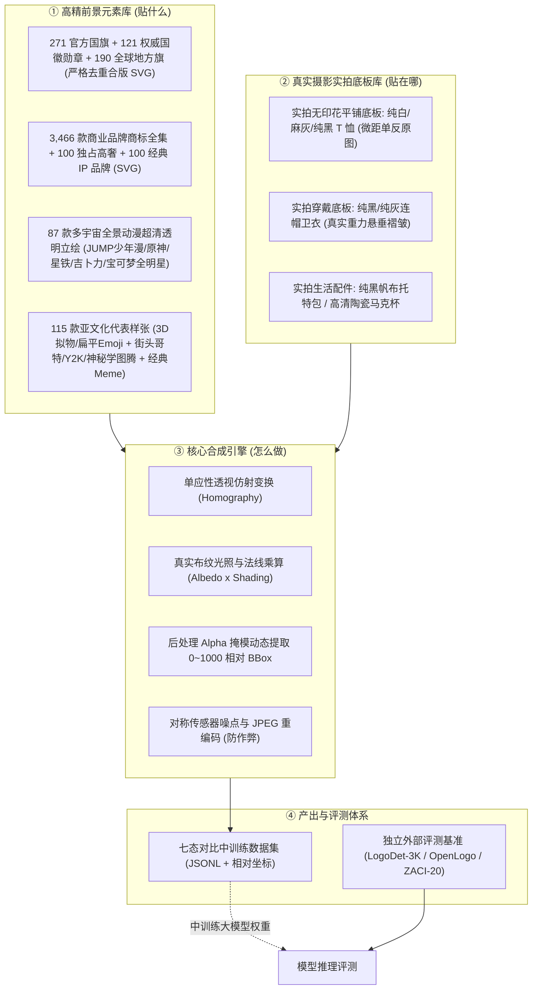

# Datawheel 多模态视觉数据飞轮：资产库全景台账与技术规范 (ASSET_CATALOG.md)

> **核心原则：** 拒绝低质抽象矢量线框与简笔画；构建由“真实高精前景元素库 + 真实摄影级商品实拍底图库 + 独立权威评测集”组成的工业级多模态数据供应链。

---

## 一、资产全景架构与三库分离原则



---

## 二、资产库细目清单与规范

### 1. 官方旗帜、国徽与地方旗帜库 (`flags_and_emblems.json`)
- **定位：** 法定图形、几何对称、严格色相拓扑、细部文字铭文识别。
- **本地目录：** `Coding/datawheel/assets/official_flags/`、`official_emblems/`、`official_regional/`
- **主要资源与来源：**
  - **`lipis/flag-icons` (MIT)：** 全球 271 个国家与独立地区官方 4:3 与 1:1 标准矢量 SVG。
  - **`Wikimedia Commons: Armorial of Sovereign States`：** 全球 121 款主权国家独立高精国徽与皇家纹章、航天徽章、名校徽章。
  - **全球地方行政区旗 (SVG)：** 190 款全球省州行政区旗（覆盖美50州、加13省区、德16联邦州、西17自治区、日47都道府县、英组成国、澳法意瑞港澳）。
- **核心混淆对图谱：**
  - 中国 (五星拱卫) $\leftrightarrow$ 越南 (单星居中) $\leftrightarrow$ 索马里 (天蓝底单星)
  - 法国 (蓝白红竖条) $\leftrightarrow$ 意大利 (绿白红竖条) $\leftrightarrow$ 爱尔兰 (绿白橙竖条)
  - 德国 (黑红金横条) $\leftrightarrow$ 比利时 (黑黄红竖条) $\leftrightarrow$ 波兰 (白红双色) $\leftrightarrow$ 印尼 (红白双色)

---

### 2. 高频商业品牌与商标 Logo 库 (`brand_logos.json`)
- **定位：** 真实电商商品（T 恤、卫衣、帽子、包、水杯）最常出现的商业标识与二创对象。
- **本地目录：** `Coding/datawheel/assets/brand_logos/icons/` (3,466 款通用商业图标)
- **主要资源与来源：** `Simple Icons` (CC0 代码与数据规范) 3,466 品牌单色官方矢量 SVG。

---

### 2.1 国际顶级高奢品牌专库 (`luxury_brands.json`) 💎
- **定位：** 专用于高客单价服装、箱包、高端腕表与奢侈品防伪微调，提供高精度纯矢量标准 Logo。
- **本地目录：** `Coding/datawheel/assets/brand_logos/luxury_100/` (**100 款** 官方纯矢量 SVG)
- **五大顶级门类全景覆盖：**
  1. **高级时装与皮具：** Gucci (古驰)、Chanel (香奈儿)、Louis Vuitton (路易威登)、Prada (普拉达)、Hermès (爱马仕)、Dior (迪奥)、Burberry (博柏利)、Balenciaga (巴黎世家)、Versace (范思哲)、Fendi (芬迪)、Givenchy (纪梵希)、Celine (思琳)、Valentino (华伦天奴)、Bottega Veneta (葆蝶家)、Saint Laurent (圣罗兰)、Balmain (巴尔曼)、Alexander McQueen (麦昆)、Loewe (罗意威)、Jacquemus (雅克穆斯)、Chloé (蔻依)、Kenzo (高田贤三)、Lanvin (浪凡)、Miu Miu (缪缪)、Moschino (莫斯奇诺)、Ferragamo (菲拉格慕)、Dolce & Gabbana (杜嘉班纳)、Giorgio Armani (阿玛尼)、Ralph Lauren (拉夫劳伦)、Ermenegildo Zegna (杰尼亚)、Brioni (布里奥尼)、Berluti (伯尔鲁帝)、Moncler (盟可睐)、Canada Goose (加拿大鹅)、Supreme、Off-White、Comme des Garçons (川久保玲)、Issey Miyake (三宅一生)、Vivienne Westwood (西太后)、Acne Studios、Stone Island (石头岛)、Arc'teryx (始祖鸟)、Rimowa (日默瓦)；
  2. **名表与高级制表：** Rolex (劳力士)、Patek Philippe (百达翡丽)、Audemars Piguet (爱彼)、Vacheron Constantin (江诗丹顿)、Jaeger-LeCoultre (积家)、Omega (欧米茄)、IWC (万国表)、Breitling (百年灵)、TAG Heuer (泰格豪雅)、Hublot (宇舶)、Panerai (沛纳海)、Chopard (萧邦)、Breguet (宝玑)、Piaget (伯爵)、Blancpain (宝珀)、Tudor (帝舵)、Longines (浪琴)、Tissot (天梭)、Zenith (真力时)、Montblanc (万宝龙)；
  3. **高级珠宝：** Cartier (卡地亚)、Tiffany & Co. (蒂芙尼)、Bvlgari (宝格丽)、Harry Winston (海瑞温斯顿)、Swarovski (施华洛世奇)、Pandora (潘多拉)、Boucheron (宝诗龙)；
  4. **顶级超跑与豪华汽车：** Ferrari (法拉利)、Porsche (保时捷)、Lamborghini (兰博基尼)、Rolls-Royce (劳斯莱斯)、Bentley (宾利)、Aston Martin (阿斯顿·马丁)、Bugatti (布加迪)、Maserati (玛莎拉蒂)、McLaren (迈凯伦)、Maybach (迈巴赫)、Pagani (帕加尼)、Koenigsegg (科尼赛克)、Lotus (路特斯)、Alfa Romeo (阿尔法·罗密欧)、Jaguar (捷豹)、Land Rover (路虎)；
  5. **高级美妆香氛与配饰：** Guerlain (娇兰)、Lancôme (兰蔻)、Estée Lauder (雅诗兰黛)、La Mer (海蓝之谜)、Byredo (百瑞德)、Creed (恺芮得)、Ray-Ban (雷朋)、Oakley (欧克利)、Fossil (化石表)、Calvin Klein、Tommy Hilfiger、Diesel、Lacoste、Coach、Michael Kors。

---

### 2.2 全球经典 IP 品牌专库 (`ip_brands.json`) 🎮
- **定位：** 二创服饰、联名卫衣、潮玩 T 恤最核心的文化 IP 标的，涵盖顶级电玩、影视、玩具与动漫品牌。
- **本地目录：** `Coding/datawheel/assets/brand_logos/ip_brands_100/` (**100 款** 官方纯矢量 SVG)
- **核心覆盖领域：**
  1. **主机巨头与游戏大厂：** Nintendo (任天堂)、PlayStation (索尼互娱)、Xbox (微软游戏)、Sega (世嘉)、Atari (雅达利)、Capcom (卡普空)、Konami (科乐美)、Bandai Namco (万代南梦宫)、Square Enix (SE)、Ubisoft (育碧)、Electronic Arts (EA)、Blizzard (暴雪娱乐)、Riot Games (拳头游戏)、Epic Games、Valve、Steam、Rockstar Games (R星)、Bethesda (B社)、CD Projekt Red (CDPR)、Mojang Studios；
  2. **传奇电玩 IP：** Super Mario (超级马力欧)、The Legend of Zelda (塞尔达传说)、Pokémon (宝可梦)、Sonic (索尼克)、Pac-Man (吃豆人)、Street Fighter (街霸)、Resident Evil (生化危机)、Monster Hunter (怪物猎人)、Tekken (铁拳)、Final Fantasy (最终幻想)、Dragon Quest (勇者斗恶龙)、Metal Gear Solid (合金装备)、Assassin's Creed (刺客信条)、GTA (侠盗猎车手)、Minecraft (我的世界)、Roblox (罗布乐思)、Fortnite (堡垒之夜)、League of Legends (英雄联盟)、Overwatch (守望先锋)、World of Warcraft (魔兽世界)、Diablo (暗黑破坏神)、Fallout (辐射)、The Elder Scrolls (上古卷轴)、Halo (光环)、Cyberpunk 2077 (赛博朋克)、The Witcher (巫师)、Donkey Kong (大金刚)、Mortal Kombat (真人快打)、The King of Fighters (拳皇)、SNK、Half-Life (半条命)、Portal (传送门)、Team Fortress (军团要塞)、Game Boy、Nintendo Switch、Steam Deck；
  3. **影视动画与超级英雄：** Walt Disney (迪士尼)、Pixar (皮克斯)、Marvel (漫威)、DC Comics (DC漫画)、Star Wars (星球大战)、Lucasfilm (卢卡斯影业)、Warner Bros. (华纳兄弟)、Universal (环球影业)、Paramount (派拉蒙)、DreamWorks (梦工厂)、20th Century Studios、MGM (米高梅)、Columbia Pictures (哥伦比亚影业)、Studio Ghibli (吉卜力工作室)、Toei Animation (东映动画)、Batman (蝙蝠侠)、Superman (超人)、Avengers (复仇者联盟)、Spider-Man (蜘蛛侠)、Iron Man (钢铁侠)、Captain America (美国队长)、Transformers (变形金刚)、Autobots (汽车人)、Decepticons (霸天虎)、Jurassic Park (侏罗纪公园)、Godzilla (哥斯拉)、Ghostbusters (抓鬼敢死队)、TMNT (忍者神龟)、Star Trek (星际迷航)、Doctor Who (神秘博士)、The Simpsons (辛普森一家)、South Park (南方公园)、Cartoon Network、Nickelodeon、Netflix、Hulu、Bilibili (哔哩哔哩)；
  4. **经典动漫与玩具潮流：** Dragon Ball Z (龙珠Z)、One Piece (海贼王)、Naruto (火影忍者)、Bleach (死神)、Attack on Titan (进击的巨人)、Demon Slayer (鬼灭之刃)、Sailor Moon (美少女战士)、Evangelion (EVA)、Gundam (高达)、Doraemon (哆啦A梦)、Astro Boy (阿童木)、Yu-Gi-Oh! (游戏王)、Digimon (数码宝贝)、Lego (乐高)、Hasbro (孩之宝)、Mattel (美泰)、Barbie (芭比)、Hot Wheels (风火轮)、Nerf (热火)、Playmobil (摩比世界)、Sanrio (三丽鸥)、Hello Kitty (凯蒂猫)、Funko Pop、Crunchyroll。

---

### 2.5 奢侈品牌设计语言、专利图式与权威参考清单 (`luxury_heritage_codes.json`)
- **定位：** 面向奢侈品“整体性认知”审核，覆盖设计语言（House Codes）、结构裁片、材质表现、专利公报与开源多模态描述。
- **免下载与高可用承诺：** **零本地磁盘存储占用**，所有官方矢量与公报索引均采用经过 HTTP 200 验证的高可用在线直链，支持按需流式调用。
- **16 大顶级奢侈品牌矩阵全景覆盖：**
  1. **路易威登 (Louis Vuitton)：** 经典 Monogram 老花拓扑（单张连续帆布倒置规则、植鞣皮马鞍手缝针脚）、Damier 棋盘格（内嵌微缩 Paris 字符）、Twist 旋转锁扣 3D 机械结构（US D735,016）。
  2. **罗意威 (LOEWE)：** 4L 缠绕 Anagram 徽标（盲盒热压印/金属镂空/提花帆布）、Puzzle 几何多边形解构包型（9 块折纸裁片拓扑、手工黑色油边凹线、EUIPO 002553147）、Flamenco 纳帕牛皮紧密同轴螺旋卷结（Flamenco Knots）。
  3. **爱马仕 (Hermès)：** Birkin / Kelly 马鞍双针斜向手缝 (Sellier 45°)、四段式穿带与转柱锁扣、Chaîne d'ancre 船锚链环、Calèche 经典四轮马车官方矢量。
  4. **香奈儿 (Chanel)：** Classic Flap 菱格纹闭合对齐规则、双 C 右上左下互扣重叠规则、皮穿金属链条、Mademoiselle 转锁。
  5. **古驰 (Gucci)：** GG Supreme 双 G 面对面互扣点阵、红绿马术腹带条纹织带 (Web Stripe)、Horsebit 1955 马衔扣、天然竹节火烤手柄 (Bamboo)。
  6. **迪奥 (Christian Dior)：** Cannage 腾格纹立体绗缝浮雕、Lady Dior 金属悬挂 DIOR 字母吊坠、Dior Oblique 倾斜刺绣老花、Saddle 不规则马鞍包型与 CD 搭扣。
  7. **普拉达 (Prada)：** 倒等腰三角形高温平整珐琅金属牌（PRADA 断腿 R 字符规范）、Saffiano 十字纹压印防水防刮牛皮专利、Re-Nylon。
  8. **葆蝶家 (Bottega Veneta)：** Intrecciato 皮革梭织编织工艺（全包外观无明示 Logo，纯靠 45° 纳帕羊皮手工真编织识别）、Jodie 提手打结、Cassette 宽幅编织。
  9. **圣罗兰 (Saint Laurent / YSL)：** Cassandre 纵向穿插金属 YSL 徽标、Chevron V 形对称人字绗缝纹样、Loulou。
  10. **思琳 (Celine)：** Triomphe 凯旋门双 C 浮雕金属锁扣与涂层帆布、Luggage 笑脸包波浪拼接前幅、Belt 鲶鱼须插带。
  11. **芬迪 (Fendi)：** Karl Lagerfeld 原创正反倒置 FF Zucca 老花、Baguette 法棍包正面大双 F 扣、Peekaboo 躲猫猫双面旋转转锁与中隔板。
  12. **高雅德 (Goyard)：** Goyardine 手绘立体凸起点阵 Y 字人字纹涂层亚麻帆布、内嵌微缩 'E: GOYARD HONORE PARIS' 字符。
  13. **巴黎世家 (Balenciaga)：** City 机车包做旧摔纹羊皮与外露铆钉、长皮须拉链头、Hourglass 沙漏包底部夸张凹弧曲线与悬挂 B 字搭扣。
  14. **博柏利 (Burberry)：** Vintage Nova Check 经典苏格兰驼/黑/白/红四色等比交叉格纹（官方矢量图谱）、经典风衣 D 型环与防风片。
  15. **卡地亚 (Cartier)：** Love 系列外露一字平头内凹螺丝钉圆坑槽几何刻印、Santos 腕表方形表圈 8 颗外露微型螺钉。
  16. **劳力士 (Rolex)：** Oyster 蚝式表壳、Fluted Bezel 三角坑纹狗牙圈精密棱面切削、泡泡镜 (Cyclops Lens) 物理 2.5 倍屈光放大率、表盘微距防伪激光皇冠。
- **外部多模态开源数据接入（在线直链）：**
  - **`GLAMI-1M` (Apache-2.0)：** 110 万件时装商品图文对，提供 191 类细粒度箱包与材质专业描述。
  - **`Fashion-Gen`：** 29.3 万张买手级多视角（正/背/侧/微距）与专业材质工艺术语。
  - **`Europeana Fashion`：** 欧洲文化遗产百年历史硬箱与工匠档案。
  - **`WIPO / EUIPO Global Design Database`：** 官方公开的 3D 线框正投影图纸与裁片装配公报。
- **双轨解耦标注体系：** 严格隔离“品牌设计归属标注 (`brand_attribution`)”与“真伪来源置信度 (`authenticity_state`)”，杜绝把算法篡改误标为假货、杜绝网络抓取图臆断真伪。

---

### 3. 动漫角色、游戏与跨界 IP 全景资产库 (`character_ips.json`)
- **定位：** 验证跨画风、多形态、局部部件拼接、异色变体与细粒度角色身份恒常性。
- **四大宇宙全景覆盖 (18 大核心原型)：**
  1. **热血少年漫与全球现象级巨头：**
     - **七龙珠 (孙悟空)：** 经典发型刺猬棱角、龟仙流橙蓝道服、胸前/背后“龟/悟”字徽、超级赛亚人金发/超蓝/银白发形态阶梯；
     - **航海王 (路飞)：** 黄色草帽红缎带、左眼下缝线刀疤、胸前 X 伤疤、五档尼卡纯白火焰发、草帽一伙骷髅海盗旗；
     - **火影忍者 (鸣人)：** 脸颊六道狐狸胡须纹、木叶护额旋涡金属刻印、橙黑运动服、晓组织黑底红云图腾；
     - **鬼灭之刃 (炭治郎)：** 绿黑等宽市松格纹羽织 (Ichimatsu)、日轮花札耳坠、额头左上方硬化烫伤疤痕。
  2. **机甲传奇与科幻里程碑：**
     - **EVA 初号机 (Test Type-01)：** 紫绿黑装甲、向前弯曲独角、下颚裂口暴走形态、NERV 半叶徽标；
     - **元祖高达 (RX-78-2)：** 白/蓝/红/黄经典三原色装甲、额头黄色 V 形天线、脸颊黑色斜切进气口。
  3. **全球潮流、萌系与治愈系图腾：**
     - **吉卜力 (龙猫 Totoro)：** 灰水滴圆滚体型、肚皮倒 V 形月牙深灰斑纹（计数任务标杆）、长硬胡须；
     - **三丽鸥 (Hello Kitty & Kuromi)：** Kitty 绝对无嘴设计、左耳红五瓣蝴蝶结；酷洛米黑小恶魔兜帽配粉骷髅；
     - **美少女战士 (月野兔)：** 金色长双马尾配双丸子头 (Odango)、额头金色月牙头冠、水手领红丝绸大蝴蝶结。
  4. **游戏超级 IP 与精灵宝可梦生态：**
     - **超级马力欧 (Mario)：** 红色工装帽白底大写红'M'、波浪黑色大八字胡、背带裤双大黄纽扣、无敌星；
     - **原神 (派蒙 Paimon)：** 头顶悬浮金色缺口光环、星空渐变内衬披风、黑色莫比乌斯发夹；
     - **宝可梦全系进化链：** 皮卡丘多形态（官方立绘/异色/像素/背影）、喷火龙（黑喷火龙异色）、伊布 8 大属性进化分支同底盘辨析群。
- **原创零版权规则积木 (Kenney Monster Pack)：**
  - CC0 1.0 Universal 原创纯几何积木（4 身体 × 6 眼型 × 5 嘴型 × 7 装饰），完全剥离预训练死记硬背，纯粹评测图元计数与空间推理。
- **外部免下载开源数据索引：**
  - **`Danbooru Tagged Dataset`：** 450 万图超大规模动漫角色层级标签库（4 万+ 角色专属 tag）；
  - **`dreMaz/AnimeInstanceSegmentationDataset`：** 高质量透明 Alpha 通道动漫角色前景提取库；
  - **`Manga109`：** 日本学术研究级黑白线稿到彩色商品跨模态评测库。

---

### 3.1 多宇宙全景动漫与跨界 IP 角色样张库 (`character_ips.json`) 👾
- **定位：** 用于服饰实物印花、胸前大图贴花与多模态角色跨画风检索的高清透明前景样本库，已完成**严格去重合版**。
- **本地目录结构：** `Coding/datawheel/assets/character_ips/` (**共计 87 款** 高清纯净透明 Alpha 通道 PNG，无多余冗余副本)
  1. **少年 JUMP 热血经典专库 (`shonen_jump/` - 16 款)：**
     - **七龙珠：** 孙悟空 (Goku - 超清 3892x3944)；
     - **航海王：** 路飞经典立绘 (3312x3080)、路飞五档尼卡形态 (1024x796)、路飞 Q 版 (667x1024)、索隆三刀流 (3960x4188)、索隆和之国篇 (2812x3456)；
     - **火影忍者：** 宇智波佐助 (2832x4264)、漩涡鸣人 (300x228)；
     - **鬼灭之刃：** 灶门炭治郎水之呼吸 (4176x4300)、炭治郎火之神神乐 (3244x4268)、灶门祢豆子 (4256x4116)、我妻善逸雷之呼吸 (2724x3972)、炼狱杏寿郎炎柱 (4152x4084)、黑死牟上弦之一 (2712x3020)；
     - **全职猎人：** 杰·富力士猜拳 (2768x4164)；
     - **进击的巨人：** 利威尔·阿克曼兵长 (512x512)。
  2. **原神全明星官方立绘专库 (`genshin/` - 25 款)：**
     - 官方 2048x1024 超清透明背景原画：钟离、雷电将军、芙宁娜、那维莱特、纳西妲、胡桃、枫原万叶、魈、甘雨、神里绫华、迪卢克、温迪、八重神子、可莉、达达利亚、流浪者(散兵)、艾尔海森、夜兰、娜维娅、阿蕾奇诺(仆人)、克洛琳德、刻晴、莫娜、宵宫、琴。
  3. **崩坏：星穹铁道官方立绘专库 (`starrail/` - 15 款)：**
     - 官方 2048x1024 超清透明背景原画：黄泉、流萤、卡芙卡、景元、黑天鹅、丹恒·饮月、刃、银狼、砂金、希儿、三月七、花火、知更鸟、托帕&账账、丹恒。
  4. **吉卜力工作室与国民殿堂 (`classics/` - 2 款)：**
     - 龙猫 Totoro (513x706 高清透明)、哆啦A梦 (Doraemon)。
  5. **精灵宝可梦全明星合版家族 (`pokemon/` - 29 款)：**
     - 初代与全系核心名将（皮卡丘、喷火龙、妙蛙种子、水箭龟、耿鬼、伊布、可达鸭、胖丁、喵喵、风速狗、胡地、怪力、大岩蛇、小拳石、烈焰马等）及伊布全套进化分支（水/雷/火/太阳/月亮伊布）与多视角变体（异色 Shiny、像素点阵 Pixel、对战背影 Back），彻底清理合版了原先的冗余重合图。
- **图像技术规范：**
  - 全部自带纯净 Alpha 透明通道（无白色背景方框、无切边锯齿、无水印）；
  - 严格保持官方原生色彩与人体/精灵结构比例；
  - 天然适配 T 恤、连帽卫衣、帆布包的布料透视变换、法线光照乘算与空间相对定位。

---

### 3.5 亚文化代表元素专库：Emoji、模因与街头神秘符号 (`subculture_elements.json`) 🔥
- **定位：** 覆盖青年亚文化、潮牌街头印花、互联网经典模因二创与跨画风视觉语义对照。
- **本地目录结构：** `Coding/datawheel/assets/subculture_elements/` (**共计 115 款**，已完成全局 MD5 去重合版)
  1. **3D 拟物光影 Emoji (`emoji_3d/` - 43 款, MIT)：**
     - 来源：`microsoft/fluentui-emoji` 官方 3D 渲染图层（$256 \times 256$ 高清透明 PNG）；
     - 覆盖：笑哭 `😂`、大哭 `😭`、骷髅 `💀`、骷髅交叉骨 `☠️`、小丑 `🤡`、恶魔笑 `😈`、融化脸 `🫠`、火焰 `🔥`、燃烧的心 `❤️‍🔥`、100分 `💯`、Y2K 闪光 `✨`、墨镜酷脸 `😎`、脑袋爆炸 `🤯`、外星人 `👽`、像素外星怪 `👾`、幽灵 `👻`、摩艾石像 `🗿`、黑心 `🖤`、心碎 `💔`、和平符号 `☮️`、阴阳 `☯️`、恶魔之眼护符 `🧿`、鬼牌小丑 `🃏`、金属礼手势 `🤘` 等。
  2. **扁平矢量 Emoji (`emoji_flat/` - 12 款, CC-BY 4.0)：**
     - 来源：`jdecked/twemoji` 标准矢量 SVG；
     - 覆盖：与 3D 拟物版一一对应的同语义跨画风对照集（笑哭、骷髅、小丑、火焰、闪光、黑心、和平、阴阳、闪电、外星人、迷幻蘑菇、彩虹），专用于评测模型对“同一符号在 3D 立体渲染 vs 2D 扁平矢量”下的语义恒常性。
  3. **街头、哥特、Y2K 与神秘学纯矢量图腾 (`street_symbols/` - 39 款, CC-BY 3.0)：**
     - 来源：`game-icons.net` 开源矢量库（已通过自动化脚本剥离原生黑底、统一转换为透明背景纯黑前景 SVG，支持任意着色与丝网印模拟）；
     - **暗黑哥特与摇滚朋克：** 骷髅交叉骨、死亡骷髅、燃烧骷髅、王冠骷髅、羊角恶魔骷髅、外星骷髅、黑桃骷髅、海盗旗、蛛网、蝙蝠翼、恶魔面具；
     - **美式复古刺青与潮牌 (Tattoo Flash & Streetwear)：** 匕首玫瑰、锁链之心、王冠之心、翼之心、破碎之心、翼剑、交叉双剑、船锚、火焰图腾、黑8台球、红唇；
     - **Y2K 与赛博机能：** 荆棘铁丝网 (`barbed_wire`)、荆棘藤 (`thorny_vine`)、荆棘冠、天使之翼、生化危险 (`biohazard`)、辐射警告 (`radioactive`)；
     - **神秘学与灵性符号 (Occult & Esoteric)：** 全视之眼 (`all_seeing_eye`)、荷鲁斯之眼 (`eye_of_horus`)、第三只眼、衔尾蛇 (`ouroboros`)、五芒星玫瑰、生命之符 (`ankh`)、三一结 (`triquetra`)、阴阳线描、莲花、和平鸽。
  4. **经典互联网模因与二创参考集 (`memes/` - 21 款)：**
     - 覆盖：神烦狗 Doge、邪恶科米蛙 (Evil Kermit)、科米蛙喝茶、Thonk 思考脸、蜘蛛侠互指 (Spider-Man Pointing)、Shut Up And Take My Money、Always Has Been、Among Us Sus、悲伤猫 (Sad Cat)、派大星震惊、基努 Woah、平面设计是我的热情、Hide the Pain Harold、灾难女孩 (Disaster Girl) 等；
     - 规范标注：清单内已对分辨率 $<200\text{px}$ 的表情包打标 `low_res: true`，对无透明通道的 JPG 打标 `needs_matting: true`，严格限定其作为 In-Context 检索参考图而非直接大图贴花。

---

### 4. 真实摄影级商品实拍底板库 (`commodity_substrates.json`)
- **定位：** 彻底摒弃简笔画和低质矢量假衣服，全部采用真实相机拍摄的白底/素色商品图。
- **主要资源与来源：**
  - **`Amazon Berkeley Objects (ABO)` (CC BY 4.0，商用友好)：**
    - 亚马逊开源，14.7 万商品条目、近 40 万张独立高分辨率实拍图。
    - 筛选目标：无印花平铺/假人纯色 T 恤 (`blank t-shirt`)、套头卫衣 (`pullover hoodie`)、帆布托特包 (`canvas tote bag`)、陶瓷马克杯 (`ceramic mug`)、牛皮纸盒 (`kraft packaging`)。
  - **`DeepFashion2` (学术协议)：**
    - 49.2 万张真实穿着、走动、人体立体起伏与复杂褶皱的服装图。
  - **商用 CC0 平铺样机图 (Studio Packshots)：**
    - 摄影棚单反实拍，自带柔光箱阴影与真实织物纤维细节。
- **质检铁律：**
  - **底板清洁排查：** 严格筛除底图上原本残留的细小未标注印花、领口标或外文字符，避免制造虚假负样本。
  - **贴附区域标定：** 每款实拍图预标定 3D 透视锚点四边形（`left_chest`, `center_chest`, `large_front`）。

---

### 5. 外部独立评测基准集合 (`evaluation_benchmarks.json`)
- **定位：** 严禁混入任何合成训练流程，专用于对模型进行真实泛化期末考试。
- **评测三大件：**
  1. **`LogoDet-3K` (15.8 万张图 / 20 万框 / 3000 类)：** 真实电商场景目标检测与定位精度（mAP@0.5）。
  2. **`QMUL-OpenLogo` (2.7 万张图 / 352 类)：** 原生附带 Clean Logo Exemplars，评测开集参考图比对（In-Context Retrieval）。
  3. **`ZACI-20` (145 万面部对 / 3.9 万角色)：** 评测跨画风角色匹配与困难负样本（Hard Negatives）排他能力。
- **评测指标：**
  - 定位精度：$\text{mAP@IoU 0.5}$ 与 $\text{mAP@IoU 0.75}$
  - 开集参考匹配：Top-1 检索准确率（Seen 类别 vs Unseen 类别）
  - 抗幻觉拒答率：在重度退化时正确输出 `insufficient_evidence` 的比例
  - 困难干扰项误报率：面对高度相似混淆项时的 False Positive Rate

---

## 三、元数据注册台账规范 (Metadata Ledger Schema)

所有资产入库时，必须统一按以下结构体写入资产清单：

```json
{
  "asset_id": "brand_nike_swoosh_canonical",
  "entity_id": "brand_nike",
  "category": "brand_sportswear",
  "variant_id": "vector_swoosh_black",
  "source_url": "https://raw.githubusercontent.com/simple-icons/simple-icons/develop/icons/nike.svg",
  "rights_status": "verified_trademark_fair_use",
  "license_reference": "Simple Icons CC0 1.0 (Trademark owned by Nike Inc.)",
  "reference_role": "canonical_reference",
  "mask_path": "assets/brands/nike_mask.png",
  "identity_verified": true,
  "confusable_distractors": ["generic_check", "offwhite"],
  "discriminative_parts": ["单侧上翘尖锐弧线", "内弯平滑度"],
  "canonical_colors": ["#111111"]
}
```


---

## 七、数据飞轮 v2 现状（2026-10 迭代）

v2 已完成从「caption parquet + 250 张预览」到「10,000 条全量渲染图文数据」的升级：

- **数据规模**：10,000 条样本 / 10,000 张渲染图（640×640；参考匹配阶段 640×840），输出 `output/datawheel_v2/dataset.parquet`。
- **五阶段课程**：A 几何色块 1,000 / B 单图元贴合 4,000 / C 多图元关系 2,500 / D 参考图匹配 1,500 / E 负样本与证据不足 1,000。
- **可印底板**：1,500 张真实底料经可印性质检（面积/纹理/明暗/肤色/背景），筛出 **447 张**分 easy/medium/hard 三档使用。
- **实体命名**：582 条官方实体名称 100% 中文化（271 国旗 / 121 国徽 / 190 地方旗），无 raw code 与英文 fallback。
- **泛化隔离**：实体级 + 底板级 split（train / val / test_unseen_entity / test_unseen_substrate / test_unseen_both）。
- **配套工具**：`tools/generate_datawheel_v2.py`、`tools/flywheel_audit.py`、`tools/export_training_data.py`、`tools/build_asset_index.py`、`tools/build_substrate_quality.py`、`tools/build_entity_name_table.py`。

> 详见 [README.md](../README.md#-v2-数据集当前主线10000-条) 与 `output/datawheel_v2/report.md`。
