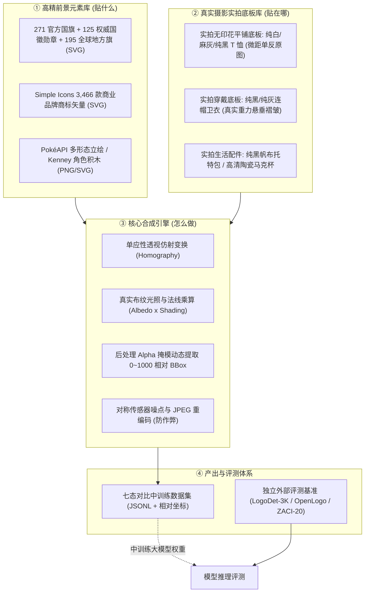

# Datawheel 多模态视觉数据飞轮：资产库全景台账与技术规范 (ASSET_CATALOG.md)

> **核心原则：** 拒绝低质抽象矢量线框与简笔画；构建由“真实高精前景元素库 + 真实摄影级商品实拍底图库 + 独立权威评测集”组成的工业级多模态数据供应链。

---

## 一、资产全景架构与三库分离原则



---

## 二、资产库细目清单与规范

### 1. 官方旗帜、国徽与地方旗帜库 (`flags_and_emblems.json`)
- **定位：** 法定图形、几何对称、严格色相拓扑、细部文字铭文识别。
- **本地目录：** `Coding/datawheel/assets/official_flags/`、`official_emblems/`、`official_regional/`
- **主要资源与来源：**
  - **`lipis/flag-icons` (MIT)：** 全球 271 个国家与独立地区官方 4:3 与 1:1 标准矢量 SVG。
  - **`Wikimedia Commons: Armorial of Sovereign States`：** 全球 125 款主权国家独立高精国徽与皇家纹章、航天徽章、名校徽章。
  - **全球地方行政区旗 (SVG)：** 195 款全球省州行政区旗（覆盖美50州、加13省区、德16联邦州、西17自治区、日47都道府县、英组成国、澳法意瑞港澳）。
- **核心混淆对图谱：**
  - 中国 (五星拱卫) $\leftrightarrow$ 越南 (单星居中) $\leftrightarrow$ 索马里 (天蓝底单星)
  - 法国 (蓝白红竖条) $\leftrightarrow$ 意大利 (绿白红竖条) $\leftrightarrow$ 爱尔兰 (绿白橙竖条)
  - 德国 (黑红金横条) $\leftrightarrow$ 比利时 (黑黄红竖条) $\leftrightarrow$ 波兰 (白红双色) $\leftrightarrow$ 印尼 (红白双色)

---

### 2. 高频商业品牌与商标 Logo 库 (`brand_logos.json`)
- **定位：** 真实电商商品（T 恤、卫衣、帽子、包、水杯）最常出现的商业标识与二创对象。
- **主要资源与来源：**
  - **`Simple Icons` (CC0 代码与数据规范)：** 3,400+ 品牌单色官方矢量 SVG，提供精准 HEX 官方色值、Slug 标识与品牌规范。
  - **`Vector Logo Zone` (各权利人版权)：** 补充多色标准矢量 Logo。
- **精选重点类别：**
  - **运动户外：** Nike、Adidas、Puma、Under Armour、The North Face、New Balance、Converse、Vans。
  - **科技数码：** Apple (带咬痕 vs 无咬痕)、Android (机器人)、PlayStation、Xbox、GitHub (Octocat)、Xiaomi。
  - **奢侈时尚：** Louis Vuitton (LV 字母交叠 + 四叶花老花)、Chanel (背对背互扣双 C)、Gucci (面对面互锁双 G)、Starbucks (双尾海妖)。
- **核心混淆对图谱：**
  - Puma (飞跃美洲狮) $\leftrightarrow$ Slazenger (平跃黑豹) $\leftrightarrow$ Jaguar (捷豹)
  - Adidas (三道阶梯斜杠) $\leftrightarrow$ Peak (三角形中空) $\leftrightarrow$ K-Swiss (五道斜杠)
  - Chanel (背对背双 C) $\leftrightarrow$ Gucci (面对面互扣双 G) $\leftrightarrow$ Under Armour (上下纵向双 U)

---

### 2.5 奢侈品牌设计语言、专利图式与权威参考清单 (`luxury_heritage_codes.json`)
- **定位：** 面向奢侈品“整体性认知”审核，覆盖设计语言（House Codes）、结构裁片、材质表现、专利公报与开源多模态描述。
- **免下载与高可用承诺：** **零本地磁盘存储占用**，所有官方矢量与公报索引均采用经过 HTTP 200 验证的高可用在线直链，支持按需流式调用。
- **16 大顶级奢侈品牌矩阵全景覆盖：**
  1. **路易威登 (Louis Vuitton)：** 经典 Monogram 老花拓扑（单张连续帆布倒置规则、植鞣皮马鞍手缝针脚）、Damier 棋盘格（内嵌微缩 Paris 字符）、Twist 旋转锁扣 3D 机械结构（US D735,016）。
  2. **罗意威 (LOEWE)：** 4L 缠绕 Anagram 徽标（盲盒热压印/金属镂空/提花帆布）、Puzzle 几何多边形解构包型（9 块折纸裁片拓扑、手工黑色油边凹线、EUIPO 002553147）、Flamenco 纳帕牛皮紧密同轴螺旋卷结（Flamenco Knots）。
  3. **爱马仕 (Hermès)：** Birkin / Kelly 马鞍双针斜向手缝 (Sellier 45°)、四段式穿带与转柱锁扣、Chaîne d'ancre 船锚链环、Calèche 经典四轮马车官方矢量。
  4. **香奈儿 (Chanel)：** Classic Flap 菱格纹闭合对齐规则、双 C 右上左下互扣重叠规则、皮穿金属链条、Mademoiselle 转锁。
  5. **古驰 (Gucci)：** GG Supreme 双 G 面对面互扣点阵、红绿马术腹带条纹织带 (Web Stripe)、Horsebit 1955 马衔扣、天然竹节火烤手柄 (Bamboo)。
  6. **迪奥 (Christian Dior)：** Cannage 腾格纹立体绗缝浮雕、Lady Dior 金属悬挂 DIOR 字母吊坠、Dior Oblique 倾斜刺绣老花、Saddle 不规则马鞍包型与 CD 搭扣。
  7. **普拉达 (Prada)：** 倒等腰三角形高温平整珐琅金属牌（PRADA 断腿 R 字符规范）、Saffiano 十字纹压印防水防刮牛皮专利、Re-Nylon。
  8. **葆蝶家 (Bottega Veneta)：** Intrecciato 皮革梭织编织工艺（全包外观无明示 Logo，纯靠 45° 纳帕羊皮手工真编织识别）、Jodie 提手打结、Cassette 宽幅编织。
  9. **圣罗兰 (Saint Laurent / YSL)：** Cassandre 纵向穿插金属 YSL 徽标、Chevron V 形对称人字绗缝纹样、Loulou。
  10. **思琳 (Celine)：** Triomphe 凯旋门双 C 浮雕金属锁扣与涂层帆布、Luggage 笑脸包波浪拼接前幅、Belt 鲶鱼须插带。
  11. **芬迪 (Fendi)：** Karl Lagerfeld 原创正反倒置 FF Zucca 老花、Baguette 法棍包正面大双 F 扣、Peekaboo 躲猫猫双面旋转转锁与中隔板。
  12. **高雅德 (Goyard)：** Goyardine 手绘立体凸起点阵 Y 字人字纹涂层亚麻帆布、内嵌微缩 'E: GOYARD HONORE PARIS' 字符。
  13. **巴黎世家 (Balenciaga)：** City 机车包做旧摔纹羊皮与外露铆钉、长皮须拉链头、Hourglass 沙漏包底部夸张凹弧曲线与悬挂 B 字搭扣。
  14. **博柏利 (Burberry)：** Vintage Nova Check 经典苏格兰驼/黑/白/红四色等比交叉格纹（官方矢量图谱）、经典风衣 D 型环与防风片。
  15. **卡地亚 (Cartier)：** Love 系列外露一字平头内凹螺丝钉圆坑槽几何刻印、Santos 腕表方形表圈 8 颗外露微型螺钉。
  16. **劳力士 (Rolex)：** Oyster 蚝式表壳、Fluted Bezel 三角坑纹狗牙圈精密棱面切削、泡泡镜 (Cyclops Lens) 物理 2.5 倍屈光放大率、表盘微距防伪激光皇冠。
- **外部多模态开源数据接入（在线直链）：**
  - **`GLAMI-1M` (Apache-2.0)：** 110 万件时装商品图文对，提供 191 类细粒度箱包与材质专业描述。
  - **`Fashion-Gen`：** 29.3 万张买手级多视角（正/背/侧/微距）与专业材质工艺术语。
  - **`Europeana Fashion`：** 欧洲文化遗产百年历史硬箱与工匠档案。
  - **`WIPO / EUIPO Global Design Database`：** 官方公开的 3D 线框正投影图纸与裁片装配公报。
- **双轨解耦标注体系：** 严格隔离“品牌设计归属标注 (`brand_attribution`)”与“真伪来源置信度 (`authenticity_state`)”，杜绝把算法篡改误标为假货、杜绝网络抓取图臆断真伪。

---

### 3. 动漫角色、游戏与跨界 IP 全景资产库 (`character_ips.json`)
- **定位：** 验证跨画风、多形态、局部部件拼接、异色变体与细粒度角色身份恒常性。
- **四大宇宙全景覆盖 (18 大核心原型)：**
  1. **热血少年漫与全球现象级巨头：**
     - **七龙珠 (孙悟空)：** 经典发型刺猬棱角、龟仙流橙蓝道服、胸前/背后“龟/悟”字徽、超级赛亚人金发/超蓝/银白发形态阶梯；
     - **航海王 (路飞)：** 黄色草帽红缎带、左眼下缝线刀疤、胸前 X 伤疤、五档尼卡纯白火焰发、草帽一伙骷髅海盗旗；
     - **火影忍者 (鸣人)：** 脸颊六道狐狸胡须纹、木叶护额旋涡金属刻印、橙黑运动服、晓组织黑底红云图腾；
     - **鬼灭之刃 (炭治郎)：** 绿黑等宽市松格纹羽织 (Ichimatsu)、日轮花札耳坠、额头左上方硬化烫伤疤痕。
  2. **机甲传奇与科幻里程碑：**
     - **EVA 初号机 (Test Type-01)：** 紫绿黑装甲、向前弯曲独角、下颚裂口暴走形态、NERV 半叶徽标；
     - **元祖高达 (RX-78-2)：** 白/蓝/红/黄经典三原色装甲、额头黄色 V 形天线、脸颊黑色斜切进气口。
  3. **全球潮流、萌系与治愈系图腾：**
     - **吉卜力 (龙猫 Totoro)：** 灰水滴圆滚体型、肚皮倒 V 形月牙深灰斑纹（计数任务标杆）、长硬胡须；
     - **三丽鸥 (Hello Kitty & Kuromi)：** Kitty 绝对无嘴设计、左耳红五瓣蝴蝶结；酷洛米黑小恶魔兜帽配粉骷髅；
     - **美少女战士 (月野兔)：** 金色长双马尾配双丸子头 (Odango)、额头金色月牙头冠、水手领红丝绸大蝴蝶结。
  4. **游戏超级 IP 与精灵宝可梦生态：**
     - **超级马力欧 (Mario)：** 红色工装帽白底大写红'M'、波浪黑色大八字胡、背带裤双大黄纽扣、无敌星；
     - **原神 (派蒙 Paimon)：** 头顶悬浮金色缺口光环、星空渐变内衬披风、黑色莫比乌斯发夹；
     - **宝可梦全系进化链：** 皮卡丘多形态（官方立绘/异色/像素/背影）、喷火龙（黑喷火龙异色）、伊布 8 大属性进化分支同底盘辨析群。
- **原创零版权规则积木 (Kenney Monster Pack)：**
  - CC0 1.0 Universal 原创纯几何积木（4 身体 × 6 眼型 × 5 嘴型 × 7 装饰），完全剥离预训练死记硬背，纯粹评测图元计数与空间推理。
- **外部免下载开源数据索引：**
  - **`Danbooru Tagged Dataset`：** 450 万图超大规模动漫角色层级标签库（4 万+ 角色专属 tag）；
  - **`dreMaz/AnimeInstanceSegmentationDataset`：** 高质量透明 Alpha 通道动漫角色前景提取库；
  - **`Manga109`：** 日本学术研究级黑白线稿到彩色商品跨模态评测库。

---

### 4. 真实摄影级商品实拍底板库 (`commodity_substrates.json`)
- **定位：** 彻底摒弃简笔画和低质矢量假衣服，全部采用真实相机拍摄的白底/素色商品图。
- **主要资源与来源：**
  - **`Amazon Berkeley Objects (ABO)` (CC BY 4.0，商用友好)：**
    - 亚马逊开源，14.7 万商品条目、近 40 万张独立高分辨率实拍图。
    - 筛选目标：无印花平铺/假人纯色 T 恤 (`blank t-shirt`)、套头卫衣 (`pullover hoodie`)、帆布托特包 (`canvas tote bag`)、陶瓷马克杯 (`ceramic mug`)、牛皮纸盒 (`kraft packaging`)。
  - **`DeepFashion2` (学术协议)：**
    - 49.2 万张真实穿着、走动、人体立体起伏与复杂褶皱的服装图。
  - **商用 CC0 平铺样机图 (Studio Packshots)：**
    - 摄影棚单反实拍，自带柔光箱阴影与真实织物纤维细节。
- **质检铁律：**
  - **底板清洁排查：** 严格筛除底图上原本残留的细小未标注印花、领口标或外文字符，避免制造虚假负样本。
  - **贴附区域标定：** 每款实拍图预标定 3D 透视锚点四边形（`left_chest`, `center_chest`, `large_front`）。

---

### 5. 外部独立评测基准集合 (`evaluation_benchmarks.json`)
- **定位：** 严禁混入任何合成训练流程，专用于对模型进行真实泛化期末考试。
- **评测三大件：**
  1. **`LogoDet-3K` (15.8 万张图 / 20 万框 / 3000 类)：** 真实电商场景目标检测与定位精度（mAP@0.5）。
  2. **`QMUL-OpenLogo` (2.7 万张图 / 352 类)：** 原生附带 Clean Logo Exemplars，评测开集参考图比对（In-Context Retrieval）。
  3. **`ZACI-20` (145 万面部对 / 3.9 万角色)：** 评测跨画风角色匹配与困难负样本（Hard Negatives）排他能力。
- **评测指标：**
  - 定位精度：$\text{mAP@IoU 0.5}$ 与 $\text{mAP@IoU 0.75}$
  - 开集参考匹配：Top-1 检索准确率（Seen 类别 vs Unseen 类别）
  - 抗幻觉拒答率：在重度退化时正确输出 `insufficient_evidence` 的比例
  - 困难干扰项误报率：面对高度相似混淆项时的 False Positive Rate

---

## 三、元数据注册台账规范 (Metadata Ledger Schema)

所有资产入库时，必须统一按以下结构体写入资产清单：

```json
{
  "asset_id": "brand_nike_swoosh_canonical",
  "entity_id": "brand_nike",
  "category": "brand_sportswear",
  "variant_id": "vector_swoosh_black",
  "source_url": "https://raw.githubusercontent.com/simple-icons/simple-icons/develop/icons/nike.svg",
  "rights_status": "verified_trademark_fair_use",
  "license_reference": "Simple Icons CC0 1.0 (Trademark owned by Nike Inc.)",
  "reference_role": "canonical_reference",
  "mask_path": "assets/brands/nike_mask.png",
  "identity_verified": true,
  "confusable_distractors": ["generic_check", "offwhite"],
  "discriminative_parts": ["单侧上翘尖锐弧线", "内弯平滑度"],
  "canonical_colors": ["#111111"]
}
```
