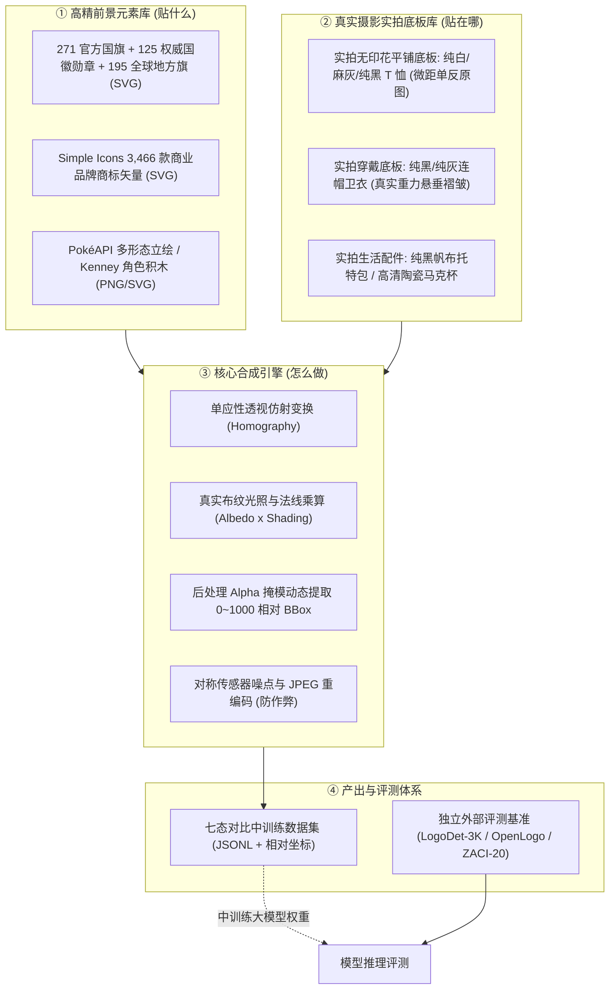

# Datawheel 多模态视觉数据飞轮：资产库全景台账与技术规范 (ASSET_CATALOG.md)

> **核心原则：** 拒绝低质抽象矢量线框与简笔画；构建由“真实高精前景元素库 + 真实摄影级商品实拍底图库 + 独立权威评测集”组成的工业级多模态数据供应链。

---

## 一、资产全景架构与三库分离原则



---

## 二、资产库细目清单与规范

### 1. 官方旗帜、国徽与地方旗帜库 (`flags_and_emblems.json`)
- **定位：** 法定图形、几何对称、严格色相拓扑、细部文字铭文识别。
- **本地目录：** `Coding/datawheel/assets/official_flags/`、`official_emblems/`、`official_regional/`
- **主要资源与来源：**
  - **`lipis/flag-icons` (MIT)：** 全球 271 个国家与独立地区官方 4:3 与 1:1 标准矢量 SVG。
  - **`Wikimedia Commons: Armorial of Sovereign States`：** 全球 125 款主权国家独立高精国徽与皇家纹章、航天徽章、名校徽章。
  - **全球地方行政区旗 (SVG)：** 195 款全球省州行政区旗（覆盖美50州、加13省区、德16联邦州、西17自治区、日47都道府县、英组成国、澳法意瑞港澳）。
- **核心混淆对图谱：**
  - 中国 (五星拱卫) $\leftrightarrow$ 越南 (单星居中) $\leftrightarrow$ 索马里 (天蓝底单星)
  - 法国 (蓝白红竖条) $\leftrightarrow$ 意大利 (绿白红竖条) $\leftrightarrow$ 爱尔兰 (绿白橙竖条)
  - 德国 (黑红金横条) $\leftrightarrow$ 比利时 (黑黄红竖条) $\leftrightarrow$ 波兰 (白红双色) $\leftrightarrow$ 印尼 (红白双色)

---

### 2. 高频商业品牌与商标 Logo 库 (`brand_logos.json`)
- **定位：** 真实电商商品（T 恤、卫衣、帽子、包、水杯）最常出现的商业标识与二创对象。
- **主要资源与来源：**
  - **`Simple Icons` (CC0 代码与数据规范)：** 3,400+ 品牌单色官方矢量 SVG，提供精准 HEX 官方色值、Slug 标识与品牌规范。
  - **`Vector Logo Zone` (各权利人版权)：** 补充多色标准矢量 Logo。
- **精选重点类别：**
  - **运动户外：** Nike、Adidas、Puma、Under Armour、The North Face、New Balance、Converse、Vans。
  - **科技数码：** Apple (带咬痕 vs 无咬痕)、Android (机器人)、PlayStation、Xbox、GitHub (Octocat)、Xiaomi。
  - **奢侈时尚：** Louis Vuitton (LV 字母交叠 + 四叶花老花)、Chanel (背对背互扣双 C)、Gucci (面对面互锁双 G)、Starbucks (双尾海妖)。
- **核心混淆对图谱：**
  - Puma (飞跃美洲狮) $\leftrightarrow$ Slazenger (平跃黑豹) $\leftrightarrow$ Jaguar (捷豹)
  - Adidas (三道阶梯斜杠) $\leftrightarrow$ Peak (三角形中空) $\leftrightarrow$ K-Swiss (五道斜杠)
  - Chanel (背对背双 C) $\leftrightarrow$ Gucci (面对面互扣双 G) $\leftrightarrow$ Under Armour (上下纵向双 U)

---

### 3. 动漫角色与可拆解 IP 资产库 (`character_ips.json`)
- **定位：** 验证跨画风、多形态、局部部件拼接与细粒度角色身份恒常性。
- **主要资源与来源：**
  - **`PokéAPI / sprites` (社区整理 / 仅限学术与技术验证)：**
    - 结构化体系：`species_id -> form_id -> artwork_version -> asset_role`。
    - 提供官方原画立绘（`official-artwork`）、像素点阵图（`pixel`）、背影视角（`back`）、异色版本（`shiny`）。
    - 典型用例：拿皮卡丘官方立绘做参考图，在衣服上贴像素版或背影版，检验模型是否真正认得身份。
  - **`Kenney Monster Builder Pack` (CC0 1.0 Universal，自由商用)：**
    - 100% 规则可控的原创积木部件（身体形态、眼睛数量 1~5、角/天线/王冠、嘴形、翅膀）。
    - 核心价值：完全剥离模型在全网预训练对知名 IP 的“死记硬背”，纯粹检验数星星、数眼睛、找不同与部件拼接能力。
  - **`dreMaz / AnimeInstanceSegmentationDataset`：**
    - 提供高质量动漫角色实例分割掩膜，用于从插画中提纯透明前景。

---

### 4. 真实摄影级商品实拍底板库 (`commodity_substrates.json`)
- **定位：** 彻底摒弃简笔画和低质矢量假衣服，全部采用真实相机拍摄的白底/素色商品图。
- **主要资源与来源：**
  - **`Amazon Berkeley Objects (ABO)` (CC BY 4.0，商用友好)：**
    - 亚马逊开源，14.7 万商品条目、近 40 万张独立高分辨率实拍图。
    - 筛选目标：无印花平铺/假人纯色 T 恤 (`blank t-shirt`)、套头卫衣 (`pullover hoodie`)、帆布托特包 (`canvas tote bag`)、陶瓷马克杯 (`ceramic mug`)、牛皮纸盒 (`kraft packaging`)。
  - **`DeepFashion2` (学术协议)：**
    - 49.2 万张真实穿着、走动、人体立体起伏与复杂褶皱的服装图。
  - **商用 CC0 平铺样机图 (Studio Packshots)：**
    - 摄影棚单反实拍，自带柔光箱阴影与真实织物纤维细节。
- **质检铁律：**
  - **底板清洁排查：** 严格筛除底图上原本残留的细小未标注印花、领口标或外文字符，避免制造虚假负样本。
  - **贴附区域标定：** 每款实拍图预标定 3D 透视锚点四边形（`left_chest`, `center_chest`, `large_front`）。

---

### 5. 外部独立评测基准集合 (`evaluation_benchmarks.json`)
- **定位：** 严禁混入任何合成训练流程，专用于对模型进行真实泛化期末考试。
- **评测三大件：**
  1. **`LogoDet-3K` (15.8 万张图 / 20 万框 / 3000 类)：** 真实电商场景目标检测与定位精度（mAP@0.5）。
  2. **`QMUL-OpenLogo` (2.7 万张图 / 352 类)：** 原生附带 Clean Logo Exemplars，评测开集参考图比对（In-Context Retrieval）。
  3. **`ZACI-20` (145 万面部对 / 3.9 万角色)：** 评测跨画风角色匹配与困难负样本（Hard Negatives）排他能力。
- **评测指标：**
  - 定位精度：$\text{mAP@IoU 0.5}$ 与 $\text{mAP@IoU 0.75}$
  - 开集参考匹配：Top-1 检索准确率（Seen 类别 vs Unseen 类别）
  - 抗幻觉拒答率：在重度退化时正确输出 `insufficient_evidence` 的比例
  - 困难干扰项误报率：面对高度相似混淆项时的 False Positive Rate

---

## 三、元数据注册台账规范 (Metadata Ledger Schema)

所有资产入库时，必须统一按以下结构体写入资产清单：

```json
{
  "asset_id": "brand_nike_swoosh_canonical",
  "entity_id": "brand_nike",
  "category": "brand_sportswear",
  "variant_id": "vector_swoosh_black",
  "source_url": "https://raw.githubusercontent.com/simple-icons/simple-icons/develop/icons/nike.svg",
  "rights_status": "verified_trademark_fair_use",
  "license_reference": "Simple Icons CC0 1.0 (Trademark owned by Nike Inc.)",
  "reference_role": "canonical_reference",
  "mask_path": "assets/brands/nike_mask.png",
  "identity_verified": true,
  "confusable_distractors": ["generic_check", "offwhite"],
  "discriminative_parts": ["单侧上翘尖锐弧线", "内弯平滑度"],
  "canonical_colors": ["#111111"]
}
```
